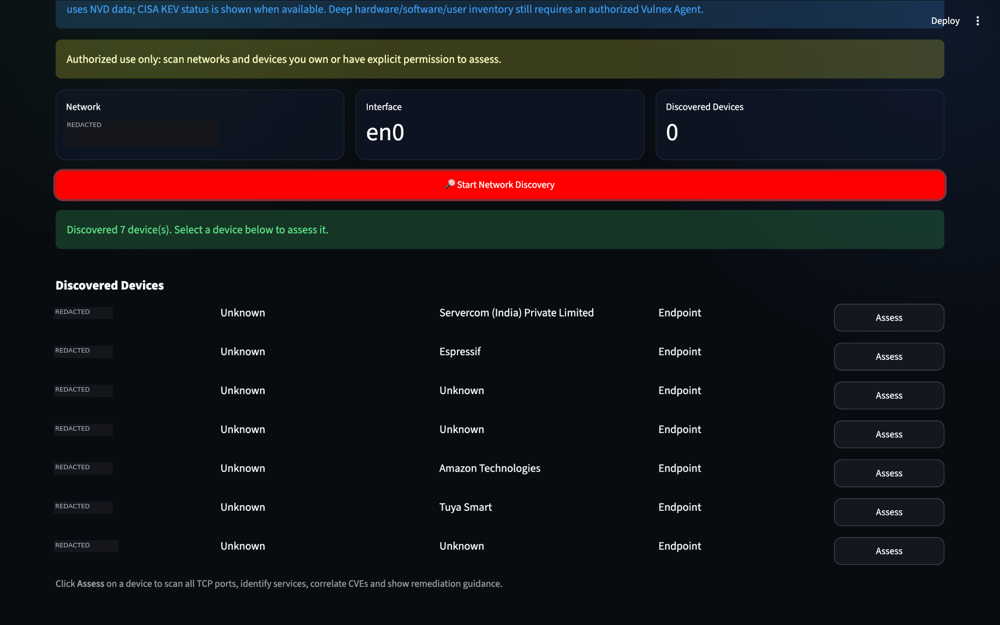
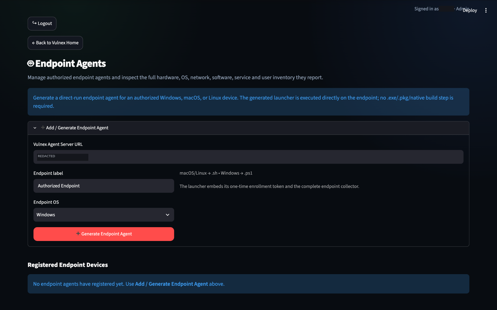
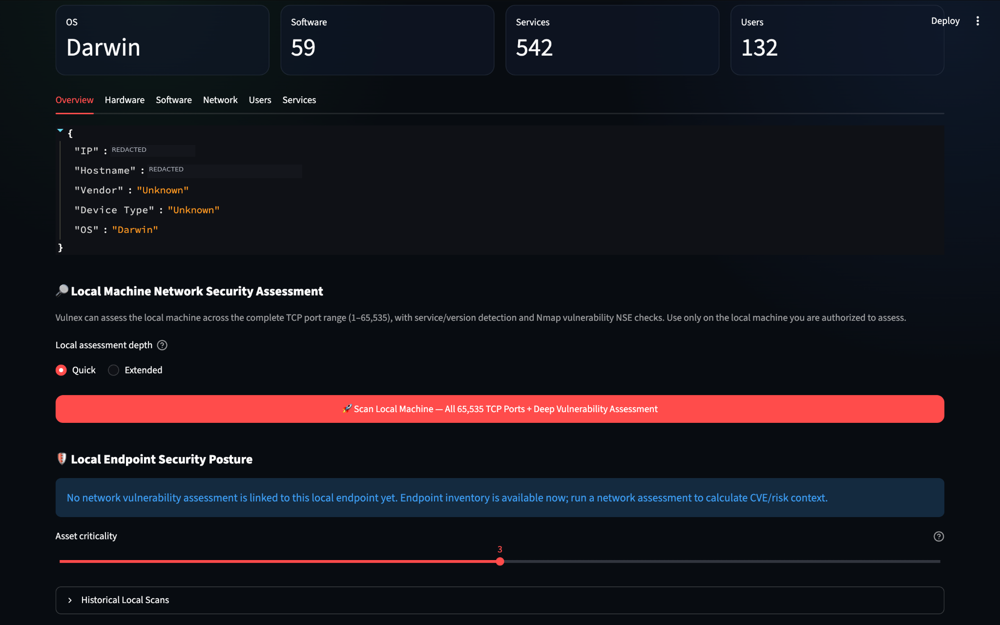
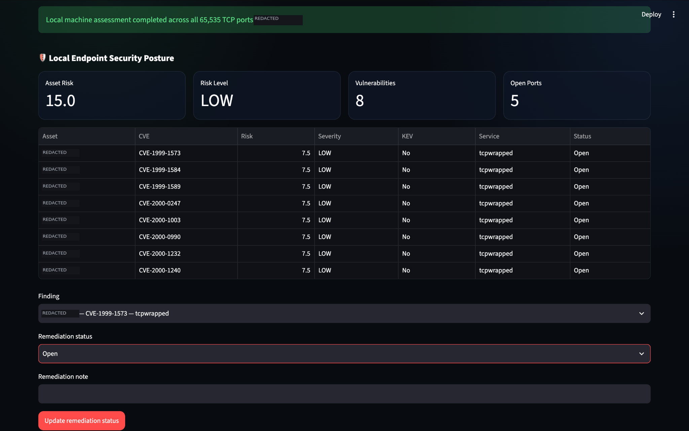
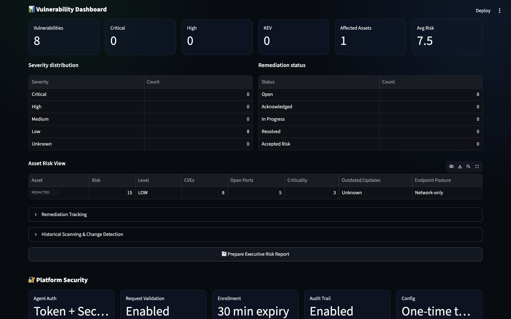
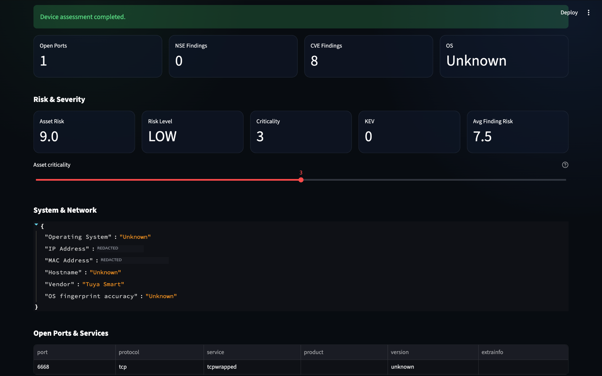
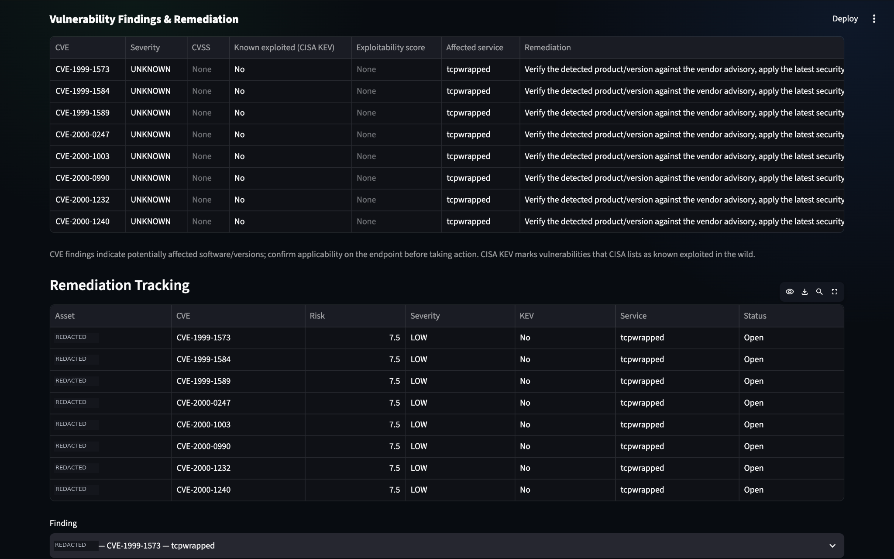
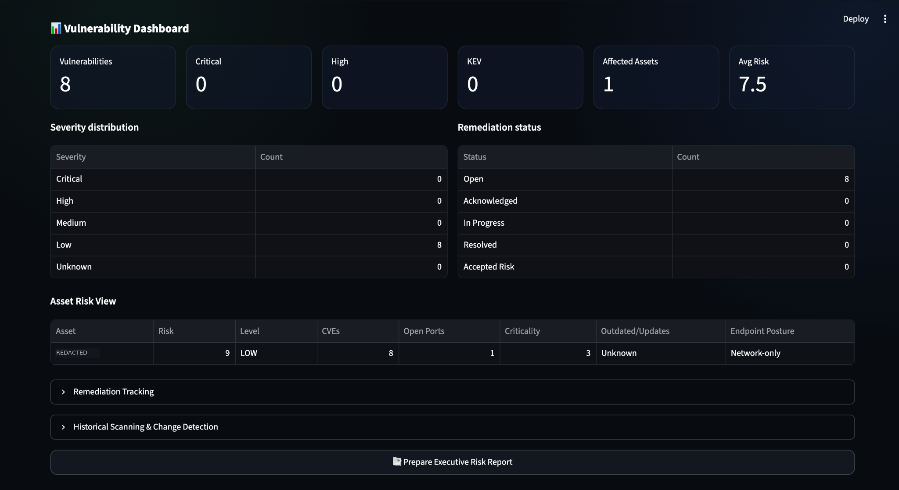

# VULNEX
### Vulnerability Assessment, Endpoint Inventory & Security Reporting

VULNEX is a Python-based security assessment platform for authorized network discovery, endpoint inventory, vulnerability context, risk prioritization, remediation tracking, and report generation. The repository includes the Phase 9 Windows-agent/Python-detection work alongside cross-platform agent and assessment workflows.

> **Authorized use only:** Run assessments only against systems and networks you own or have explicit permission to test.

## Highlights

- **Network discovery and assessment** using Nmap to identify reachable hosts and exposed services.
- **Cross-platform endpoint inventory** with agent workflows for macOS, Linux, and Windows PowerShell.
- **Hardware and software inventory** including system details, network configuration, installed software, services, and supported user/account metadata.
- **Endpoint agent management** for enrollment, heartbeats, and platform-specific background operation.
- **Vulnerability context and risk prioritization** using CVE information, CISA Known Exploited Vulnerabilities (KEV) context when available, and project risk-scoring logic.
- **Remediation tracking** for recording finding status and assessment history.
- **Authentication and role-based access control** with administrator and standard-user capabilities.
- **PDF reporting** for assessment and device findings.
- **Local persistence and automated tests** for core application workflows.

## License

**VULNEX is proprietary software. All rights reserved.** This repository is public for viewing, but public visibility does not grant permission to use, copy, modify, distribute, sublicense, or commercially exploit the source code. Permission must be obtained in writing from the copyright holder unless applicable law expressly permits otherwise. See [`LICENSE`](LICENSE) for the full notice. Contact the copyright holder through the owner’s GitHub profile to request permission or a commercial license.

## Screenshots

Selected screenshots from the VULNEX interface and example assessment workflows. Images are stored in [`docs/screenshots/`](docs/screenshots/). The displayed values are illustrative of the captured test environment; verify that screenshots are safe to share before distributing the repository.

| Network discovery | Endpoint agent management |
| --- | --- |
|  |  |

| Local machine assessment | Vulnerability dashboard |
| --- | --- |
|  |  |

| Assessment results | Risk and remediation overview |
| --- | --- |
|  |  |

| Device findings | Remediation tracking |
| --- | --- |
|  |  |

## Project layout

| Path | Purpose |
| --- | --- |
| `app.py` | Application entry point and dashboard |
| `scanner.py`, `nmap_locator.py` | Scanning workflow and Nmap discovery |
| `discovery/` | Network discovery helpers |
| `agent/` | Endpoint agent and collector |
| `agent_server.py` | Agent communication/API component |
| `collectors/` | Host and system data collectors |
| `auth_manager.py`, `security_store.py` | Authentication and security-related persistence |
| `cve_fetcher.py`, `risk_engine.py` | Vulnerability context and risk scoring |
| `remediation_engine.py` | Remediation workflow |
| `report_generator.py` | PDF/report generation |
| `models/`, `storage/` | Data models and persistence helpers |
| `tests/` | Automated tests |
| `docs/` | Complete project documentation and screenshots |
| `scans/` | Local scan data and reports; runtime data should not be committed |

Phase-specific implementation notes are available in the `README_*.md` files, including [the endpoint agent guide](README_AGENT.md), [authentication and RBAC](README_PHASE8_AUTH_RBAC.md), and [virtual environment setup](README_VENV_SETUP.md).

## Requirements

- Python 3.10 or newer is recommended; use a version compatible with the installed dependencies.
- Nmap is required for network scanning and must be installed separately.
- Internet access is needed to install Python packages and for features that retrieve external vulnerability information.

### Install Nmap

- **macOS (Homebrew):** `brew install nmap`
- **Debian/Ubuntu:** `sudo apt install nmap`
- **Windows:** Install Nmap from [nmap.org/download.html](https://nmap.org/download.html) and ensure its installation directory is available on `PATH`.

## Quick start

Run commands from the repository root.

### macOS / Linux

```bash
python3 app.py
```

### Windows PowerShell

```powershell
py -3 app.py
```

VULNEX is designed to create and reuse a project-local `.venv` when its bootstrap workflow is available. The first setup requires an internet connection. If automatic bootstrap is unavailable, create the environment manually.

**macOS / Linux**

```bash
python3 -m venv .venv
source .venv/bin/activate
python -m pip install --upgrade pip
pip install -r requirements.txt
python app.py
```

**Windows PowerShell**

```powershell
py -3 -m venv .venv
.\\.venv\\Scripts\\Activate.ps1
python -m pip install --upgrade pip
pip install -r requirements.txt
python app.py
```

For agent-specific dependencies, when needed:

```bash
python -m pip install -r agent/requirements.txt
```

## Endpoint agent

The project documents direct-run agent launchers for supported platforms:

| Platform | Launcher | Shell |
| --- | --- | --- |
| macOS | `.sh` | Terminal / Bash |
| Linux | `.sh` | Terminal / Bash |
| Windows | `.ps1` | PowerShell |

Generated launchers are intended to include a one-time enrollment token and start the agent using an isolated Python environment. For persistent background operation, startup after reboot, and registration details, follow [README_AGENT.md](README_AGENT.md). Registering a system service or scheduled task may require administrator/root privileges.

The agent is intended to collect inventory data and send endpoint profiles to the configured VULNEX server. Review the collection scope and server configuration before deploying it to real endpoints.

## Authentication and access control

VULNEX includes account approval and role-based access controls. New accounts may require administrator approval before login. Administrator and standard-user permissions differ; see [README_PHASE8_AUTH_RBAC.md](README_PHASE8_AUTH_RBAC.md).

Do not expose the dashboard or agent API to untrusted networks without reviewing authentication, network binding, TLS/reverse-proxy configuration, and secret handling.

## Tests

From the repository root:

```bash
python -m pytest -q
```

A successful test run does not by itself verify Nmap scans, platform-specific service installation, Windows endpoint collection, or external CVE lookups on every target system. Validate those workflows on the platforms where you intend to deploy VULNEX.

## Security and data hygiene

- Assess only systems for which you have explicit authorization.
- Never commit passwords, API keys, enrollment tokens, session files, private keys, or other secrets.
- Keep authentication/session data, logs, endpoint inventories, scan results, and reports private; they may contain sensitive information.
- Use least privilege. Do not run the entire dashboard as root/Administrator unless a documented operation specifically requires it.
- Follow the phase-specific Nmap privilege guidance instead of running the entire dashboard with `sudo`.
- Review agent enrollment, server URL, firewall rules, and permissions before deployment.
- Trust forwarded client-IP headers only when they come from a trusted reverse proxy.

## Documentation

- [Complete VULNEX project documentation (PDF)](docs/Vulnex_Complete_Project_Documentation.pdf)
- [Endpoint agent guide](README_AGENT.md)
- [Authentication and RBAC](README_PHASE8_AUTH_RBAC.md)
- [Automatic virtual environment setup](README_VENV_SETUP.md)

## Disclaimer

VULNEX is intended for authorized security assessment, defensive testing, and educational use. You are responsible for obtaining required permissions and complying with applicable laws, policies, and third-party terms.
